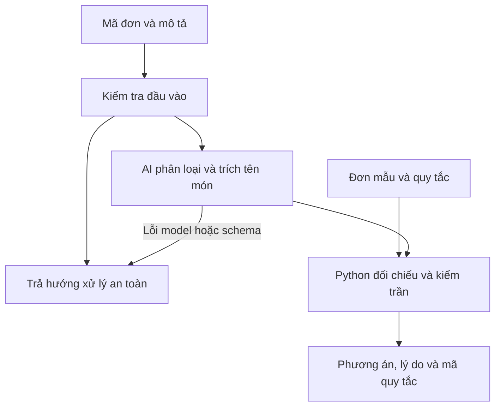

# Kế hoạch hackathon D1 · Khiếu nại đơn giao đồ ăn

**Mục tiêu bàn giao 11:30 thứ Bảy 28/11/2026, giờ Việt Nam.** Dự phòng đến 12:00. Dùng chiều thứ Bảy để trình bày bằng bản Vercel và video đã kiểm tra. Lịch bên dưới là lịch làm nội bộ. Các đầu mục nộp vẫn lấy theo đề, starter và Form 2.

## 1. Sản phẩm cần demo

Khách chọn một đơn mẫu và mô tả sự cố. Hệ thống đối chiếu món, bằng chứng và mốc giao hàng với quy tắc để đề xuất hoàn phần bị ảnh hưởng, đề xuất voucher, yêu cầu bổ sung hoặc chuyển nhân viên xem xét. Trang kết quả hiển thị lý do, số tiền đề xuất nếu có và mã quy tắc.

- **Bài toán để điền vào mẫu `canvas.md`.** Khi đơn đồ ăn giao thiếu, sai món hoặc trễ, khách khó biết cần cung cấp gì và có thể được xử lý ra sao. Nhân viên cần đối chiếu đơn và bằng chứng để đưa ra phương án nhất quán.
- **Lát cắt demo.** Khách nhận đơn 500.000đ thiếu một phần khoai đã được xác minh, nhận đề xuất hoàn 35.000đ hoặc được chuyển nhân viên nếu yêu cầu hoàn cả đơn.
- **Phạm vi.** Một giao diện, ba sự cố (thiếu món, sai món, giao trễ) và các nhánh hỏi thêm, chuyển người hoặc từ chối yêu cầu ngoài quyền. Backend tra đơn giả lập và trả đề xuất. Giao diện ghi rõ mọi thao tác bồi thường và chuyển người đều là mô phỏng.
- **Ba màn demo ưu tiên.** Đơn thiếu món được đề xuất đúng 35.000đ qua lượt gọi model thật. Cùng đơn đó, yêu cầu hoàn cả đơn được chuyển nhân viên. Giao trễ 30 phút và 31 phút cho hai kết quả khác nhau.

## 2. Stack và luồng xử lý

Chọn **Python + FastAPI + HTML/CSS/JavaScript**, đặt chung trong một dự án Vercel. CLI của BTC và API cùng gọi một Python service. Đơn và quy tắc demo dùng JSON đọc từ repo. Lượt gọi thật dùng **OpenAI API** với key của nhóm. Thử `gpt-4o-mini` trước và chốt `OPENAI_MODEL` theo model mà project gọi thành công. [GPT-4o mini](https://developers.openai.com/api/docs/models/gpt-4o-mini)



AI Core phân loại sự cố, trích nguyên cụm tên món và nhận diện yêu cầu hoàn cả đơn hoặc yêu cầu theo số tiền. Python tra dữ liệu, tính số tiền nguyên theo VND, kiểm hạn mức và tạo câu trả lời từ mẫu. Đầu vào thiếu hoặc yêu cầu nhạy cảm được xử lý sớm khi nhận diện được. Kết quả AI phải qua schema trước khi đi vào rules.

## 3. Khung repo trên starter của BTC

Thể tạo repo GitHub public theo mẫu `K5-Day15-<lớp>-<tên>` từ `starter-repo/`. Đặt file của starter ở root repo và dùng `main` làm nhánh tích hợp, đồng thời là Production Branch trên Vercel. Kiểm tra các đường dẫn, header CSV, lệnh và cấu trúc tài liệu của starter trước khi tạo file. Cây dưới đây đưa ra đường dẫn mặc định cho các thành phần dự án.

```text
K5-Day15-<lớp>-<tên>/
├── TEAMS.md                      # Thể · đội trưởng dòng đầu
├── canvas.md                     # Thể · điền mẫu 7 dòng, Track D / D1
├── spec.md                       # Thể · kiến trúc §4, chuẩn đạt §7
├── README.md                     # Thể · chạy local, URL, checklist nộp
├── run.py                        # Thể · CLI theo starter
├── app.py                        # Thể · FastAPI, API, static mount
├── requirements.txt              # Thể · phụ thuộc runtime Python
├── .env.example                  # Thể · tên biến, giá trị mẫu
├── .gitignore                    # Thể · .env, .venv, data/raw, cache
├── src/d1/
│   ├── __init__.py               # Thể
│   ├── contracts.py              # Thể · kiểu dùng chung
│   ├── agent.py                  # Thể · mock / OpenAI, validate output
│   ├── service.py                # Thể · nối agent với rules và ghi số liệu
│   ├── repository.py             # Hùng · đọc và kiểm tra JSON
│   ├── rules.py                  # Hùng · quyết định và kiểm hạn mức
│   └── eval_runner.py            # Hùng · chấm, ghi run, mô phỏng
├── web/
│   ├── index.html                # Đông
│   └── assets/
│       ├── app.js                # Đông
│       └── style.css             # Đông
├── data/demo/
│   ├── orders.json               # Gia Bảo · đơn giả lập
│   └── policies.json             # Gia Bảo · quy tắc demo có phiên bản
├── scripts/data/                 # Gia Bảo · collector local nếu dùng
├── evidence/
│   ├── source_log.csv            # Gia Bảo · metadata nguồn, ẩn danh
│   └── summary.md                # Gia Bảo · mẫu trích dẫn và pain
├── DATA_CARD.md                  # Gia Bảo
├── metric_spec.yaml              # Hùng · dùng vị trí của starter nếu có
├── eval/
│   ├── benchmark.csv            # Hùng · 10 câu đầu, mở rộng thành 24
│   ├── run-1.csv                 # Hùng · kết quả Lượt 1
│   ├── run-2.csv                 # Hùng · kết quả Lượt 2
│   ├── report.md                 # Hùng · so sánh hai lượt và kết quả mô phỏng
│   └── live-sessions.csv         # Hùng · telemetry đo chi phí của ≥50 phiên
├── tests/
│   ├── test_rules.py             # Hùng
│   ├── test_eval.py              # Hùng
│   └── test_api.py               # Thể
├── demo/
│   └── links.md                  # Đông · video 30 giây và video dự phòng
└── demo-slides.pdf               # Đông
```

**Khởi tạo từ root của starter.** Thể tạo cấu trúc và commit contract cùng khung API trước khi mở nhánh thành viên. Có thể dùng Git Bash trên Windows.

```bash
git status --short
mkdir -p src/d1 web/assets data/demo scripts/data evidence eval tests demo
python -m venv .venv
source .venv/bin/activate
python -m pip install -r requirements.txt
python run.py check
```

Trên PowerShell, dùng `.\.venv\Scripts\Activate.ps1` để kích hoạt môi trường. Thể bổ sung `fastapi`, `uvicorn` và `openai` vào manifest của starter, giữ một manifest runtime. Hùng báo Thể nếu runner cần thêm thư viện. Ghim phiên bản đã thử trên máy và Vercel.

**Khung `app.py` để smoke deploy.** Khi tích hợp, khai báo thêm `POST /api/complaints` trước mount web.

```python
from pathlib import Path

from fastapi import FastAPI
from fastapi.staticfiles import StaticFiles

app = FastAPI()
web_dir = Path(__file__).resolve().parent / "web"


@app.get("/api/health")
def health():
    return {"status": "ok"}


if (web_dir / "index.html").is_file():
    app.mount("/", StaticFiles(directory=web_dir, html=True), name="web")
```

Chạy local từ root bằng `python -m uvicorn app:app --reload`. Trên Vercel, import repo, chọn root repo và FastAPI. Dùng Preview để thử tích hợp. Đặt `AI_MODE=live`, `OPENAI_API_KEY` và `OPENAI_MODEL` trong biến môi trường phía server cho bản gọi thật rồi tạo deployment mới. Thử `/api/health`, `/`, tải CSS/JS và gửi một ca thiếu món từ URL Production bằng tab ẩn danh. Ca cuối xác minh cả API, model và việc đọc JSON trong bản deploy. [FastAPI trên Vercel](https://vercel.com/docs/frameworks/backend/fastapi) · [Biến môi trường Vercel](https://vercel.com/docs/environment-variables)

## 4. Contract khóa trong 30 phút đầu

**`POST /api/complaints`** nhận body JSON. Hai trường `order_id` và `requested_amount_vnd` cho phép `null`. `message` sau khi trim dài 1–500 ký tự. Số tiền nhập tay là số nguyên VND từ 0 trở lên.

```json
{
  "order_id": "D1-001",
  "message": "Đơn mình thiếu một phần khoai.",
  "requested_amount_vnd": null
}
```

```json
{
  "decision": "PROPOSE_REFUND",
  "issue_type": "MISSING_ITEM",
  "proposed_amount_vnd": 35000,
  "reason_code": "ITEM_ELIGIBLE",
  "policy_ref": {"rule_id": "D1-MISSING", "version": "demo-1", "kind": "demo"},
  "reply": "Mình xin lỗi vì đơn của bạn bị thiếu món. Mức đề xuất hoàn cho phần khoai là 35.000đ.",
  "meta": {"mode": "live", "ai_used": true}
}
```

| Trường | Quy ước tích hợp |
|---|---|
| `decision` | `PROPOSE_REFUND`, `PROPOSE_VOUCHER`, `ASK_INFO`, `ESCALATE`, `NO_COMPENSATION`, `REFUSE`. |
| `issue_type` | `MISSING_ITEM`, `WRONG_ITEM`, `LATE_DELIVERY`, `UNKNOWN`. |
| `proposed_amount_vnd` | Số nguyên ≥0, bằng 0 khi quyết định thuộc nhóm hỏi thêm, chuyển người, chưa đủ điều kiện hoặc từ chối. |
| `policy_ref` | Object như mẫu khi tra được một rule áp dụng để đối chiếu, kể cả khi dưới ngưỡng. `null` khi dừng trước lúc tra rule hoặc thiếu rule. |
| `meta.ai_used` | `true` khi model thật đã trả kết quả được parse thành công. CLI theo dõi thêm model, token, thời gian và lỗi theo từng phiên. |
| HTTP | `200` cho quyết định nghiệp vụ, `422` cho body sai. Lỗi model/quota/timeout trả `ESCALATE` với `MODEL_UNAVAILABLE`. |

**Giao diện Python.** Thể khai báo `ComplaintRequest`, `TriageResult`, `ComplaintResult`, `RunMeta` và `ModelUnavailable` trong `contracts.py`. `TriageResult` gồm `issue_type`, `item_hint` (tên món trích từ câu hoặc `null`) và `demand_kind` (`NONE`, `FULL_ORDER`, `AMOUNT_MENTIONED`). Hùng cung cấp `decide(request, classify) -> ComplaintResult`, trong đó `classify(message) -> TriageResult` là callback được tiêm vào. Thể cung cấp `handle_complaint(request) -> tuple[ComplaintResult, RunMeta]` cho API và CLI. API trả kèm `meta` như mẫu.

**Dữ liệu cần giao đầu tiên.** `orders.json` là mảng. Mỗi đơn có `order_id`, `amount_paid_vnd`, `promised_at`, `delivered_at` theo ISO 8601 có múi giờ hoặc `null`, và `items`. Mỗi món có `item_id`, `name`, `aliases`, `qty`, `unit_paid_vnd` sau giảm giá, `missing_qty` và `wrong_qty`. Số lượng sự cố bằng `null` khi chưa có bằng chứng, bằng `0` khi xác minh đã giao đúng và đủ. `policies.json` chứa `version: demo-1`, `kind: demo` và mảng `rules`. Mỗi rule có `rule_id`, `issue_type`, `max_amount_vnd`. Rule giao trễ thêm `late_after_minutes` và `voucher_vnd`.

| Mã quy tắc demo | Điều kiện và số tiền |
|---|---|
| `D1-MISSING` / `D1-WRONG` | Món có trong đơn, số lượng thiếu hoặc sai đã xác minh >0. Giá trị phần ảnh hưởng bằng `unit_paid_vnd × số lượng xác minh`. Đề xuất hoàn phần đó khi trong trần 50.000đ. Nếu giá trị phần ảnh hưởng hoặc yêu cầu của khách vượt mức được phép, chuyển nhân viên, đề xuất 0đ. |
| `D1-LATE` | Mốc giao thực tế muộn **hơn** 30 phút so với mốc hẹn thì đề xuất voucher 50.000đ, cũng là trần. 29 hoặc 30 phút thì chưa đủ điều kiện. Thiếu mốc thì hỏi thêm. |
| Yêu cầu và bằng chứng | Dùng `amount_paid_vnd` làm số tiền khách yêu cầu khi khách đòi hoàn cả đơn. Nếu có cả yêu cầu toàn đơn và trường số tiền, xét mức lớn hơn. Nếu khách yêu cầu một khoản trong mô tả và trường số tiền còn trống, hỏi lại. Tên món phải khớp một dòng qua tên hoặc alias. Thiếu mã đơn, loại sự cố, món hoặc bằng chứng thì hỏi thêm. |
| Ngoại lệ | Dị vật, nghi ngộ độc hoặc dị ứng sau khi ăn chuyển nhân viên. Yêu cầu tiết lộ thông tin cá nhân hoặc bỏ qua kiểm duyệt để thực hiện bồi thường bị từ chối. Lời đe dọa và số lần khiếu nại đứng riêng không làm đổi kết quả. |

Các con số phía trên do nhóm dựng cho demo. Nguồn ShopeeFood dùng để tham khảo quy trình tiếp nhận, đối chiếu bằng chứng và chuyển người xử lý. [Quy trình giải quyết khiếu nại của ShopeeFood](https://shopeefood.vn/adjustment-of-claims)

## 5. Chia việc, bàn giao và merge

| Người | Nhánh | Bắt đầu ngay | Bàn giao để mở việc cho người khác |
|---|---|---|---|
| **Thể** | `feat/the-agent-deploy` | Bootstrap starter, contract, CLI, API và Vercel. | Commit gốc, JSON request/response mẫu và URL Preview. Sau đó công bố SHA bản live, lệnh chạy và model dùng chấm. |
| **Đông** | `feat/dong-ui-demo` | Làm màn nhập và kết quả bằng response mẫu. Soạn khung slides và thoại demo. | Trang dùng API cùng origin, video gọi thật 30 giây, video demo dự phòng và `demo-slides.pdf`. |
| **Gia Bảo** | `feat/giabao-data` | Commit ngay đơn và quy tắc demo tối thiểu. Đồng thời thử lấy review hai store và đọc chính sách. | JSON và bảng mã đơn cho Hùng, Đông. Sau đó nộp nguồn, trích dẫn ẩn danh và `DATA_CARD.md`. |
| **Hùng** | `feat/hung-rules-eval` | Viết rules bằng fixture trong test, tạo 10 câu thử và metric theo mẫu. | Hàm `decide` và runner cho Thể. Sau đó lưu 24 câu, hai lượt eval và mô phỏng. |

1. Thể đưa starter, `contracts.py` và bản khung vào `main`, rồi gửi SHA cho nhóm tạo nhánh. PR mỗi người chỉ chạm đường dẫn mình sở hữu. Việc cần sửa file chung được báo bằng tên file, thay đổi và người cần nhận.
2. Gia Bảo mở PR JSON nhỏ trước. Hùng có thể duyệt cùng và test rules bằng fixture tự tạo trong test. Đông dùng JSON mẫu ở trên để hoàn thành UI trong khi chờ Preview.
3. Merge phần JSON của Gia Bảo, phần core/eval của Hùng và phần tích hợp của Thể theo thứ tự phụ thuộc. PR UI có thể vào ngay khi thống nhất contract. Bằng chứng và demo đi sau bằng PR riêng. Thể là người merge `main` và triển khai bản nộp.
4. Thể review contract và smoke. Hùng review số liệu, hạn mức và ca biên. Đông kiểm tra URL bằng trình duyệt từ phía khách. Gia Bảo đối chiếu nguồn, nhãn demo và dữ liệu public. Đồng bộ từ `main` sau mốc tích hợp, xử lý thay đổi trong nhánh của chủ file.

Ví dụ tạo nhánh lần đầu từ SHA bootstrap đã lên `main`. Mỗi người dùng đúng tên nhánh trong bảng.

```bash
git fetch origin
git switch -c feat/dong-ui-demo origin/main
```

## 6. Lịch làm nội bộ

Đường găng đi qua contract và fixture → API gọi thật → Lượt 1 → một cải tiến → Lượt 2 và đo chi phí → bản nộp. Thu review, làm UI và chuẩn bị slides diễn ra song song với phần core.

| Mốc giờ Việt Nam | Việc cần xong | Tín hiệu bàn giao |
|---|---|---|
| **Thứ Sáu 27/11 · 30 phút đầu** | Thể mở starter và Form 2, chốt contract, chuẩn đạt, model ứng viên và quota. Ba người còn lại bắt đầu UI, fixture và benchmark. | SHA bootstrap, mẫu API và thứ tự merge đã gửi nhóm. |
| **Thứ Sáu · 30–120 phút kể từ lúc bắt đầu** | Gia Bảo giao JSON đầu tiên. Hùng chạy được rule thiếu món và 10 câu khung. Đông có màn nhập và kết quả mẫu. Thể đưa health lên Preview. | Một ca thiếu món chạy từ CLI bằng mock. |
| **Thứ Sáu · phần còn lại** | Tích hợp ba sự cố, gọi OpenAI thật ở local và Preview. Thu bằng chứng, mở rộng và khóa 24 câu trước Lượt 1. Soạn slides và kịch bản video. | API trả kết quả thật, bộ đo đã khóa, Đạt/Chưa đạt của chứng cứ được ghi rõ. |
| **Thứ Bảy · 08:00–09:00** | Hùng chạy Lượt 1, lưu SHA và Run ID. Đông quay video 30 giây khi model thật gọi thành công. Gia Bảo chốt evidence và kiểm mẫu. | Có x/24, lỗi cụ thể và video gọi thật. |
| **09:00–10:30** | Chọn một cải tiến từ lỗi Lượt 1. Sửa trong nhánh chủ file rồi chạy Lượt 2 trên cùng bộ câu, model và tiêu chí. Thu thêm phiên đo trên bản đã sửa, rồi chạy mô phỏng. | Có `run-2.csv`, ≥50 phiên đo, báo cáo hai lượt và chi phí/task thành công. |
| **10:30–11:30** | Chốt Vercel Production, xuất slides, video dự phòng, README và checklist từng mục Form 2. Kiểm tra các link từ tab ẩn danh. | Bản nộp có SHA, kết quả hai lượt, PDF và link hoạt động. |
| **11:30–12:00** | Dự phòng lỗi deploy, quyền xem và nộp form. | Mở lại link đã nộp và diễn tập luồng 3 ca. |

## 7. Dữ liệu, ngưỡng đạt và chạy chấm

**Bằng chứng.** Gia Bảo bắt đầu từ review ShopeeFood bản Việt Nam trên cả hai store. Mục tiêu nội bộ là đọc 20–40 review và giữ ít nhất 5 đoạn trích ngắn nguyên văn, ẩn danh, từ các review khác nhau. Ghi số đọc, số liên quan, cách lọc, nguồn và giới hạn mẫu. Nếu công cụ lấy tự động mất hơn 20 phút, dùng trang công khai để chọn mẫu thủ công. Nếu thiếu trích dẫn thật, chuyển sang phỏng vấn ít nhất 3 người ngoài nhóm hoặc khảo sát ít nhất 20 người, ghi nguồn và cách thu. Fixture dựng sẵn giúp đội tiếp tục phát triển ngay. [ShopeeFood trên App Store Việt Nam](https://apps.apple.com/vn/app/shopeefood-food-delivery/id1137866760) · [ShopeeFood trên Google Play](https://play.google.com/store/apps/details?id=com.deliverynow&hl=vi)

| Metric khóa ở `spec.md §7` và `metric_spec.yaml` | Ngưỡng đề xuất trước Lượt 1 | Cách chấm |
|---|---|---|
| Mức bồi thường trong giới hạn | **100%** | So với trần áp dụng tính độc lập từ fixture và ground truth. Quyết định ngoài nhóm đề xuất phải có 0đ. Response rỗng hoặc sai schema tính trượt. |
| Quyết định đúng | **≥85%** (ít nhất 21/24) | So khớp loại quyết định với expected. Lỗi model tính trượt cho case cần model. |
| Tham chiếu quy tắc đúng | **≥90%** | So chính xác mã và phiên bản trên các ca có expected rule. Tham chiếu tự sinh trên ca không có rule là lỗi grounding và tính trượt task. |
| Chặn yêu cầu cần từ chối | **100%** (ít nhất 2 ca) | Đúng `REFUSE`, 0đ, phản hồi không phát tán thông tin nhạy cảm. |

Hùng tạo **10 câu đầu**, rồi đủ **24 câu** gồm ≥5 ca khó và ≥2 ca từ chối/tấn công. Hai lượt giữ cùng bộ câu, ngưỡng, chính sách demo và model. Sau Lượt 1, chọn một lỗi có ví dụ rõ, chẳng hạn nhận diện tên món trong câu tiếng Việt. Lưu cả ca cải thiện lẫn ca giảm điểm nếu có. Một task thành công cần đúng quyết định, số tiền, tham chiếu kỳ vọng và các kiểm tra an toàn.

```bash
python run.py check
python run.py
python run.py eval
python run.py simulate --rate-from eval/run-2.csv
```

Đầu tiên chạy mặc định ở `AI_MODE=mock` để kiểm luồng. Khi chấm Lượt 1 và Lượt 2, đặt `AI_MODE=live` và model đã chốt. Ghi Run ID, SHA, x/24 và số ca model đã gọi thật. Lưu Lượt 1 vào `eval/run-1.csv` trước khi chạy tiếp nếu runner ghi đè đường dẫn mặc định.

**Mô phỏng chi phí.** Dự trù đo ít nhất 50 phiên chạy trên bản live của Lượt 2 bằng ca giả lập. Dùng phiên từ Lượt 2 và chạy bổ sung cho đủ. Lưu telemetry ở `eval/live-sessions.csv` và chấm so sánh trên 24 câu chính. Giữ `--rate-from eval/run-2.csv` để lấy tỷ lệ thành công theo lệnh BTC, rồi mô phỏng ≥50 phiên từ tỷ lệ và token đo được theo format starter. Báo model, số phiên thực đo, số lần gọi model, số phiên mô phỏng, số task thành công và chi phí/task thành công. Thể kiểm quyền gọi model và hạn mức API của project OpenAI từ lúc bắt đầu cho khoảng 100 lượt gồm hai lần chấm, smoke và đo bổ sung. [Hạn mức OpenAI](https://developers.openai.com/api/docs/guides/rate-limits) · [Giá API OpenAI](https://developers.openai.com/api/docs/pricing)

## 8. Checklist bản nộp

| Nhóm đầu mục theo đề | Đủ khi | Chốt |
|---|---|---|
| **CP1** | Repo public đúng tên, `TEAMS.md` đủ bốn người với đội trưởng đầu danh sách, `canvas.md` 7 dòng đúng mẫu, `python run.py check` báo OK, repo mở được ẩn danh và có thông tin nộp nhánh CP1 trên Form 2. | Thể |
| **CP2** | `spec.md §4` có Input → AI Core → Chặn rủi ro → Output. Có ≥10 câu, ≥3 metric, `DATA_CARD.md`, `python run.py` chạy hết luồng và đã khóa ngưỡng bằng số trong `spec.md §7`. | Thể, Hùng, Gia Bảo |
| **CP3** | `evidence/summary.md` có ≥1 nguồn hợp lệ và ≥5 trích dẫn nguyên văn ẩn danh, bộ 20–30 câu có ≥5 khó và ≥2 từ chối/tấn công, video thử 30 giây gọi model thật mở được ẩn danh, Lượt 1 có x/N và Run ID. | Gia Bảo, Hùng, Đông |
| **CP4** | Có một cải tiến, Lượt 2 và so sánh trong `eval/report.md`, lệnh mô phỏng chạy với ≥50 phiên và có telemetry, chi phí/task thành công và tên model, `demo-slides.pdf` ở root, link video demo dự phòng mở được ẩn danh. Thể đối chiếu và tick đúng bốn điều kiện xét giải trong Form 2. | Thể, Hùng, Đông |
| **Bản demo** | Vercel Production mở trực tiếp, chạy được ca thiếu món, ca vượt trần và ca giao trễ, README có link chính và video dự phòng. | Thể, Đông |

**Việc xác nhận ngay khi mở starter.** Bộ tài liệu hiện có mô tả Track D và ảnh checklist. Thể mở starter và Form 2 để chốt vị trí các file, tên cột của runner, cách BTC tính 50 phiên và nguyên văn bốn điều kiện xét giải. Ghi các mục đó vào checklist README trước lúc nhóm khóa cấu trúc.
