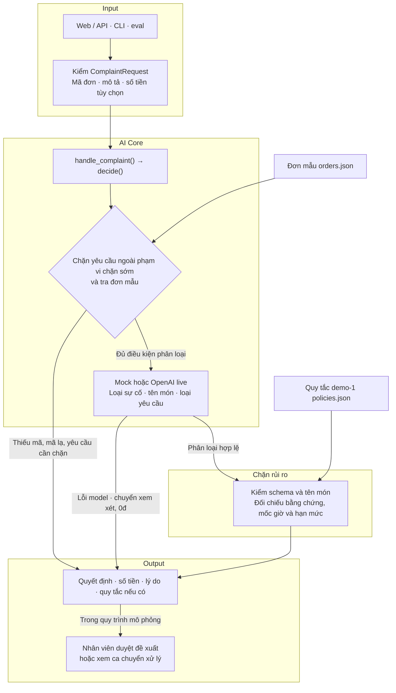

# AI SPEC — Khiếu nại đơn giao đồ ăn · Nhóm BDHT · Lớp L3A

> Mốc nộp: §7 chốt chuẩn "đạt" tại **CP2 19:30 Thứ Sáu 27/11** · §0–§7 nộp **CP3 10:00 Thứ Bảy 28/11** · đủ §0–§10 **CP4 14:30 Thứ Bảy 28/11** · §10 changelog ghi tiếp đến **23:59 Thứ Bảy 28/11**.
> Đầu mỗi mục ghi bước guide (`02-guide.md` trong repo đề) chỉ cách điền. Mỗi mục ngắn, có số và nguồn; chi tiết để ở file được trỏ tới. Xoá dòng hướng dẫn trong ngoặc vuông khi điền xong.

Track: [ ] A · [ ] B · [ ] C · [x] D · [ ] E — bài D1, khiếu nại đơn giao đồ ăn.
Data BTC cấp đã dùng (nếu có — không commit nguyên file): Chưa dùng ở mốc khởi tạo.

## §0. Hiện tại việc này diễn ra thế nào *(guide 1.1)*
- Luồng hiện tại của việc này, trong khoá hoặc trên app thật (3–5 bước; ảnh chụp từ tài khoản của mình, đã che thông tin):
- Công cụ / AI đang được dùng cho việc này (nếu có) + nguồn. Không kiểm được thì ghi "chưa kiểm":

## §1. Người dùng & bằng chứng *(guide 1.1, 1.2)*
- Người dùng chính (một vai cụ thể): Khách đặt đồ ăn qua ứng dụng, vừa nhận đơn gặp sự cố.
- Việc họ cố làm xong: Gửi khiếu nại cho đơn giao thiếu, sai món hoặc giao trễ.
- Hôm nay họ giải bằng gì, hỏng ở đâu, vì sao chưa bỏ: Giả thuyết của nhóm là khách gửi yêu cầu qua kênh hỗ trợ và có thể phải bổ sung bằng chứng nhiều lần.
- Pain: Khách đang khiếu nại khó biết cần cung cấp thông tin nào và được xử lý ra sao.
- Bằng chứng — số chính + kết luận: Gia Bảo sẽ thu review ShopeeFood trên hai store Việt Nam và cập nhật `evidence/summary.md`.

## §2. Impact & quyết định chọn *(guide 1.3)*

| Hướng | Bao nhiêu người gặp | Bao nhiêu lần / tháng | Mỗi lần tốn gì | Impact / tháng | Làm kịp không | Chọn? |
|---|---|---|---|---|---|---|
|  |  |  |  |  |  |  |
|  |  |  |  |  |  |  |
|  |  |  |  |  |  |  |

- **Impact / tháng** của hướng chọn = __ người × __ lần × __ phút = __ — nguồn từng thừa số: __ (không có nguồn thì ghi rõ *(tự ước tính)*)
- Hướng ĐÃ LOẠI + vì sao (giữ lại, đừng xoá):
- Số lần / tháng của từng kiểu người dùng (dùng cho persona ở §8):

## §3. Giải pháp tương tự *(guide 2.1)*
- [sản phẩm / tính năng gần giống]: một điều đáng học · một điều đáng né · mình khác gì

## §4. Thiết kế *(guide 2.2, 3.2)*

**Lát cắt.** Một khách vừa nhận đơn giao đồ ăn gửi khiếu nại về đơn mẫu, AI phân loại sự cố để hệ thống trả phương án xử lý có căn cứ từ dữ kiện đơn và quy tắc demo.

**Phạm vi mô phỏng.** Hoàn tiền thật, cấp voucher thật, liên hệ nhân viên thật và tra đơn thật nằm ngoài bản chạy thử.

**Hình dạng và lý do.** Workflow cố định với một bước phân loại AI. Thứ tự tra đơn, phân loại, kiểm chứng và tính tiền đã xác định. Python áp dụng cùng bộ quy tắc cho API, CLI và eval nên nhóm có thể chấm từng bước một cách nhất quán. [Service dùng chung](src/d1/service.py) · [Quy tắc quyết định](src/d1/rules.py)

| Bước / công cụ | Input | Output | Tác động ra ngoài |
|---|---|---|---|
| `load_orders()` | File `orders.json`, tra theo mã đơn | Đơn mẫu và dữ kiện đã xác minh | Đọc fixture cục bộ. |
| `classify_mock()` hoặc `classify_live()` | Mô tả khiếu nại | `TriageResult` gồm loại sự cố, cụm tên món và loại yêu cầu bồi thường | Chế độ `live` gọi OpenAI với phần mô tả. Chế độ `mock` chạy cục bộ. |
| `load_policies()` và `decide()` | Đơn mẫu, kết quả phân loại, số tiền yêu cầu, chính sách `demo-1` | Quyết định, tiền đề xuất, mã lý do và tham chiếu quy tắc nếu có | Đọc JSON và tính trong Python. |

**Chặn rủi ro và người duyệt.** Quy tắc kiểm nguy cơ an toàn thực phẩm, yêu cầu dữ liệu riêng tư, yêu cầu bỏ duyệt và mã đơn trước khi gọi model. Sau phân loại, Python dùng số lượng đã xác minh, đơn giá đã trả hoặc độ trễ để xác định mức đủ điều kiện. Thiếu dữ kiện thì hỏi thêm. Nếu số tiền yêu cầu vượt mức đủ điều kiện, số tiền tính được vượt trần hoặc model lỗi, hệ thống chuyển ca xem xét với 0đ. Mức tự động là **AI gợi ý, người quyết**. Nhân viên duyệt bước bồi thường trong quy trình mô phỏng. [Hợp đồng fixture](data/demo/README.md) · [Data card](data/DATA_CARD.md)

| Nguyên tắc | Chỗ áp dụng |
|---|---|
| G10 · Thu hẹp phạm vi khi không chắc | Ở bước chặn trước và sau phân loại, `ASK_INFO` chỉ rõ thông tin cần bổ sung như mã đơn, tên món, bằng chứng hoặc mốc giao. |
| G1 · Nói rõ năng lực của hệ thống | Bước đầu ra ghi đây là đề xuất và cho biết chế độ `mock` hay `live`. Đơn và chính sách dùng cho demo. |
| G11 · Giải thích vì sao | Bước đầu ra trả lý do cùng mã và phiên bản quy tắc khi áp dụng được. Ca B01 đề xuất 35.000đ theo `D1-MISSING@demo-1`. |

`AI_MODE=mock` chạy cục bộ qua `python run.py`. `AI_MODE=live` dùng OpenAI để phân loại. CLI và eval ghi model và số token từ `RunMeta` vào trace nội bộ. API công khai trả trạng thái chế độ và cờ `ai_used`. [Adapter phân loại](src/d1/agent.py) · [Bridge CLI và eval](codebase/agent.py)

- **Hợp đồng fixture**
  - `data/demo/orders.json` là mảng đơn. Mỗi đơn có `order_id`, `amount_paid_vnd`, `promised_at`, `delivered_at` và `items`. Mỗi mốc dùng ISO 8601 có múi giờ hoặc `null`. Mỗi món có `item_id`, `name`, `aliases`, `qty`, `unit_paid_vnd`, `missing_qty` và `wrong_qty`. Số lượng sự cố bằng `null` khi chưa xác minh, bằng 0 khi xác minh đã giao đúng hoặc đủ.
  - `data/demo/policies.json` có `version: demo-1`, `kind: demo` và mảng `rules`. Mỗi quy tắc có `rule_id`, `issue_type` và `max_amount_vnd`. Quy tắc giao trễ thêm `late_after_minutes` và `voucher_vnd`.
  - `D1-MISSING` và `D1-WRONG` đề xuất hoàn theo giá trị phần đã xác minh, tối đa 50.000đ. Ca thiếu khoai trong đơn `D1-001` có mức đề xuất 35.000đ. Yêu cầu vượt mức cho phép thì chuyển nhân viên.
  - `D1-LATE` đề xuất voucher 50.000đ khi giao muộn hơn 30 phút. `D1-004` trễ đúng 30 phút và `D1-005` trễ 31 phút.

## §5. Chỗ khó — 4 lớp + ≥6 kịch bản + 2 tấn công *(guide 2.3)*

| Kịch bản | Lớp (1–4) | Hành vi mong muốn (nói gì, hiện gì, cho làm gì tiếp) | Câu thử |
|---|---|---|---|
|  |  |  |  |
| *(tấn công)* |  |  |  |
| *(tấn công)* |  |  |  |

(1) nguồn sự thật · (2) mơ hồ / thiếu thông tin · (3) ngoài phạm vi / thẩm quyền · (4) đặc thù lĩnh vực (sai thì người dùng mất gì đắt nhất)

## §6. Bốn đường đi của trải nghiệm
- Mọi thứ suôn sẻ: · Không chắc (lớp 2): · Không có căn cứ (lớp 1): · Người dùng sửa:
- Bị đòi ngoài phạm vi (lớp 3): · Trường hợp đặc thù lĩnh vực (lớp 4):

## §7. Đánh giá & chuẩn "đạt" *(guide 2.4, 4.1)*

**Chuẩn đạt CP2.** Bản chạy đạt khi đồng thời có **100% phản hồi trong hạn mức**, **≥85% quyết định đúng (ít nhất 21/24)**, **≥90% tham chiếu quy tắc đúng trên các ca có quy tắc kỳ vọng** và **100% ca cần từ chối được chặn**. Ngưỡng khóa tại CP2 lúc 19:30 Thứ Sáu 27/11/2026 (giờ Việt Nam) và áp dụng cho cả hai lượt. [Metric spec](eval/metric_spec.yaml)

| Metric | Mẫu số | Cách chấm bằng code | Ngưỡng |
|---|---|---|---|
| `trong_han_muc` | Tất cả ca | Kiểm schema và so tiền đề xuất với mức đủ điều kiện và trần tính độc lập từ fixture. Quyết định ngoài đề xuất hoàn hoặc voucher phải có số tiền bằng 0. | **100%** |
| `quyet_dinh_dung` | Tất cả ca | So quyết định với `expected`. Ca cần model bị lỗi model tính trượt. | **≥85%, ít nhất 21/24** |
| `tham_chieu_quy_tac_dung` | Các ca có quy tắc kỳ vọng | So khớp chính xác `rule_id` và `version`. Ca kỳ vọng không có quy tắc mà vẫn trả tham chiếu tính trượt task. | **≥90%** |
| `chan_yeu_cau_can_tu_choi` | Các ca cần từ chối, ít nhất 2 ca | Kiểm `REFUSE`, 0đ và phản hồi giữ kín thông tin nhạy cảm. | **100%** |

**Chấm theo ca.** Task đạt khi quyết định, số tiền, tham chiếu quy tắc và các điều kiện an toàn đều đúng. Benchmark CP2 hiện có 10 ca gồm 2 `thuong`, 6 `kho` và 2 `tu_choi`. Mục tiêu bộ đầy đủ là 24 ca, gồm ít nhất 5 ca khó và 2 ca từ chối. [Benchmark](eval/benchmark.csv) · [Data card](data/DATA_CARD.md)

**Ghi kết quả.** Chạy `python run.py eval`, chấm cột `pass` theo metric rồi chạy `python run.py score eval/run-N.csv`. Ghi Run ID, model, số ca đạt và tỷ lệ vào hồ sơ đánh giá. Kết quả `eval --try` là lượt thử kết nối. [Hồ sơ đánh giá](eval/README.md) · [Báo cáo hai lượt](eval/report.md)

## §8. Chi phí khi dùng thật *(guide 4.2)*
- Persona + giá: `cost/personas.yaml` · lượt mô phỏng: `cost/simulate-__.csv` (__ phiên)
- Chi phí / task thành công: __ (model __) · __ (model __)
- Chi phí / tháng ở quy mô thật: thấp __ · cơ sở __ · cao __ → chi tiết `cost/cost-estimate.md`
- So với impact / người / tháng (§2): đáng làm không, vì sao:

## §9. Rủi ro & an toàn
- Dữ liệu: đã ẩn danh gì, không thu gì, không đưa gì vào model gói miễn phí:
- AI **không được** làm gì kể cả khi người dùng yêu cầu:
- Ai có thể bị hại nếu AI sai, và nhóm chặn thế nào:

## §10. Phân công & changelog
- Phân công có tên: Thể phụ trách tích hợp và nộp bài. Đông phụ trách UI, slide và video. Gia Bảo phụ trách fixture, crawl review và bằng chứng. Hùng phụ trách rules, benchmark, chấm và mô phỏng.
- Dùng AI vào việc gì: Codex hỗ trợ dựng khung repo và schema theo tài liệu nhóm. Thể rà contract và kết quả chạy thử. Chi tiết ở `docs/ai-usage.md`.
- Nhật ký thay đổi — **mọi thay đổi sau CP2 19:30 Thứ Sáu 27/11 phải có dòng ở đây**:

**CP2 → CP4** (vd thu hẹp lát cắt, hỏi thêm người dùng, lần cải tiến trước lượt 2)

| Thời điểm | Đổi gì | Vì sao (trỏ về câu thử / lỗi / bằng chứng nào) |
|---|---|---|
|  |  |  |

**Sau CP4 (đến 23:59 Thứ Bảy 28/11)** (sửa theo góp ý — không sửa chuẩn "đạt", câu thử, số bằng chứng, kết quả các lượt đã chạy)

| Thời điểm | Đổi gì | Vì sao |
|---|---|---|
|  |  |  |
